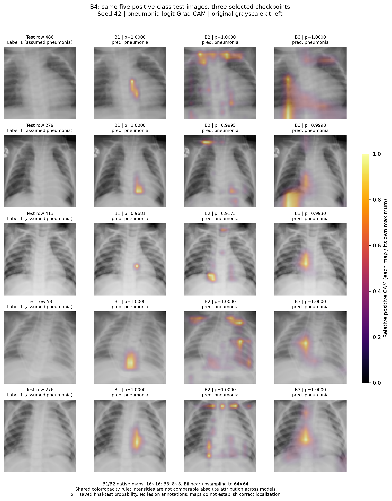

# B4 Grad-CAM method and numerical comparison draft

Selected test row IDs **[486, 279, 413, 53, 276]**, seed **42**, uniformly without replacement among all 390 label-1 test rows. Indices were saved before explanations, and all three models use these same five images in the same order. Class 1 is interpreted as pneumonia under the existing assumption; the archive has no semantic class-name metadata. “Representative” means random examples of the supplied positive-class partition, without choosing by appearance, predictions, or map quality.

The exact selected B1/B2/B3 checkpoints use final main-path convolutions `features.conv3.conv`, `features.conv6.conv`, and `features.block64.conv2.conv`. Models remain in evaluation mode with gradients enabled. Captum `LayerGradCam.attribute` targets the unrestricted positive-class logit (`target=None` for scalar-per-row outputs), layer output before its BN/ReLU, with `relu_attributions=True`. Averaged spatial gradients weight each activation channel; their weighted sum is followed by ReLU. Native grids are 16×16, 16×16, and 8×8. This is coarse localization via the selected layer, including only B3's selected main convolution rather than a separate map of its shortcut route. [Captum documentation](https://captum.ai/api/layer.html#captum.attr.LayerGradCam), [Selvaraju et al. Grad-CAM paper](https://arxiv.org/abs/1610.02391).

Positive maps are bilinearly interpolated to 64×64 and divided by their own maximum. Zero maps remain zero and have transparent overlays. Originals retain uint8 grayscale range 0–255 and archive orientation. All overlays use inferno, heat range 0–1, and alpha=0.55×normalized heat. Equal colors across panels describe relative within-map importance, not equal absolute attribution. Titles reuse saved final-test probabilities. No full-test performance is recomputed or used for tuning.

To match the original CUDA inference shapes, each attribution batch is padded by repeating only the selected images: B1 uses 128 rows and B2/B3 use 16 rows. The five retained rows' logits and probabilities match their saved final-test values exactly; all padding maps are discarded. Evaluation-mode BN/dropout keep rows independent. The runner also handles a selected image originating from a partial final batch. An initial five-row attempt was stopped by its probability/logit check, retained under `../b4_attempt_001/`, and repeated with the same fixed selection after resolving batch-shape numerical variation. Tolerances were not relaxed. PyTorch documents that floating-point results can vary between batch shapes; the exact kernel cause was not isolated. [PyTorch numerical-accuracy notes](https://docs.pytorch.org/docs/2.11/notes/numerical_accuracy.html).

| Test row | Model | Saved pneumonia probability | Native grid | Peak (x,y), displayed image | CAM mass in outer 8-pixel frame |
| --- | --- | ---: | --- | --- | ---: |
| 486 | B1 | 1.000000 | 16×16 | 34, 30 | 0.00% |
| 486 | B2 | 1.000000 | 16×16 | 14, 6 | 42.66% |
| 486 | B3 | 1.000000 | 8×8 | 12, 60 | 32.17% |
| 279 | B1 | 0.999998 | 16×16 | 38, 49 | 0.00% |
| 279 | B2 | 0.999512 | 16×16 | 18, 6 | 55.83% |
| 279 | B3 | 0.999833 | 8×8 | 12, 60 | 36.98% |
| 413 | B1 | 0.968064 | 16×16 | 37, 38 | 0.00% |
| 413 | B2 | 0.917330 | 16×16 | 22, 46 | 12.93% |
| 413 | B3 | 0.993003 | 8×8 | 27, 35 | 0.00% |
| 53 | B1 | 1.000000 | 16×16 | 33, 45 | 0.00% |
| 53 | B2 | 1.000000 | 16×16 | 49, 26 | 34.40% |
| 53 | B3 | 0.999997 | 8×8 | 27, 28 | 9.21% |
| 276 | B1 | 1.000000 | 16×16 | 38, 37 | 0.00% |
| 276 | B2 | 0.999976 | 16×16 | 45, 5 | 37.29% |
| 276 | B3 | 0.999992 | 8×8 | 27, 35 | 16.09% |

The geometric statistic counts positive interpolated CAM mass within the image's outer eight-pixel frame (43.75% of pixels). It is not a lung or lesion mask, and it cannot measure disease localization or establish a causal reliance on borders. Peak coordinates use the archive's displayed upper-left origin and are not anatomical laterality labels. Raw signed/positive maps, activations, gradients, weights, original pixels, row IDs, and saved/attribution probabilities are retained in `gradcam.pt`; CSVs preserve all fifteen map records.

Compare highlighted regions with visible grayscale opacity in the original panels, while recognizing that white regions may include bones and other structures. Visual overlap with bright/cloudy areas is qualitative, not a diagnosis or lesion-localization validation. Smaller native grids and interpolation can broaden or smooth hotspots. Saturated probability does not guarantee anatomical faithfulness. No lesion/lung annotations or patient identities are provided, and these five examples do not establish performance or a general architecture ranking. See the separately written B4 experiment report for image-by-image visual observations.
