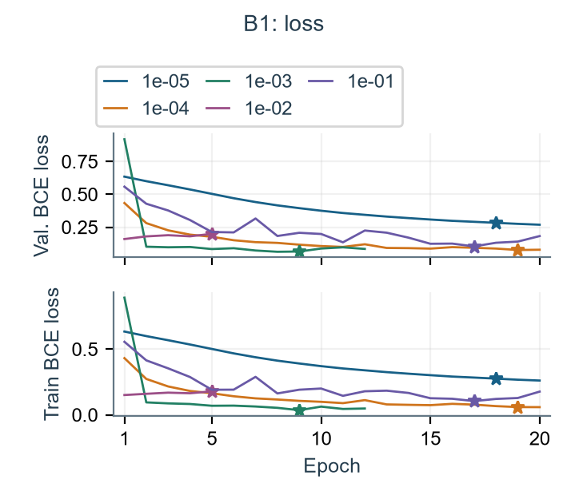
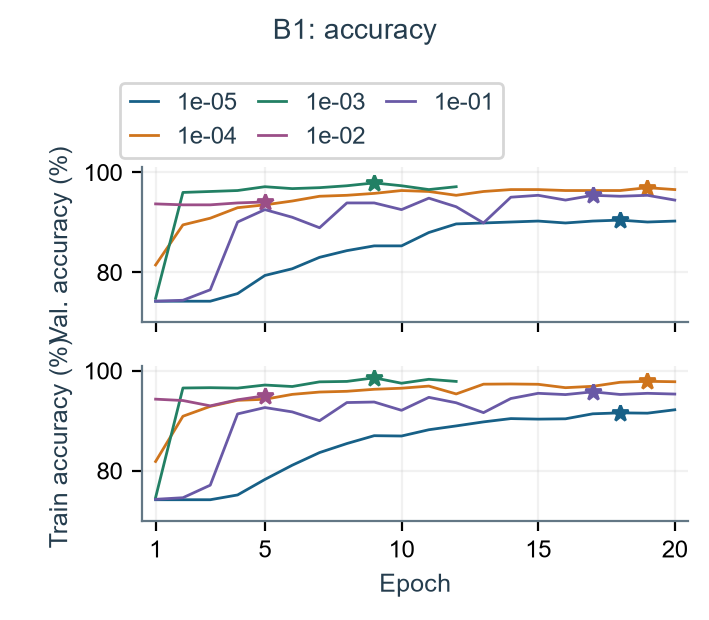
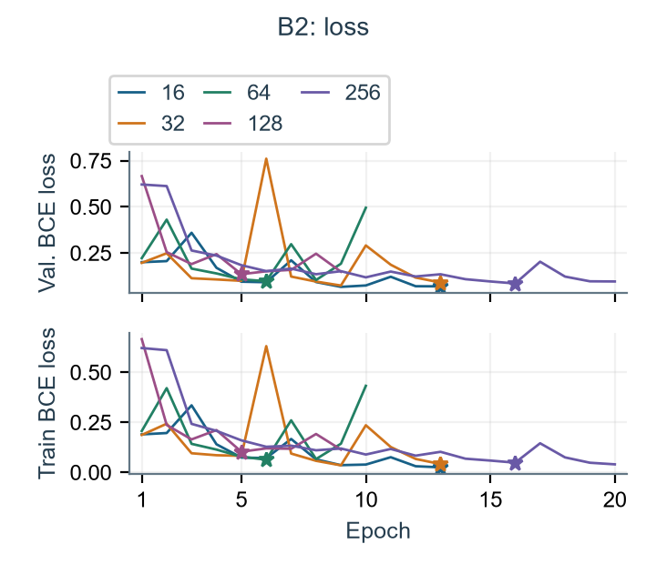
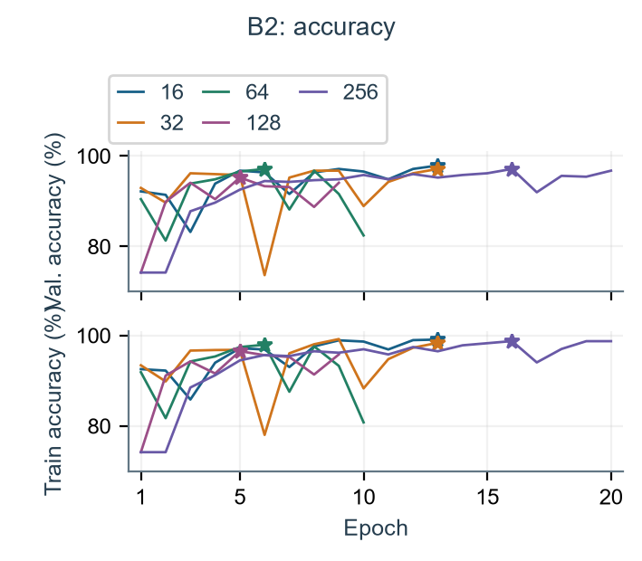
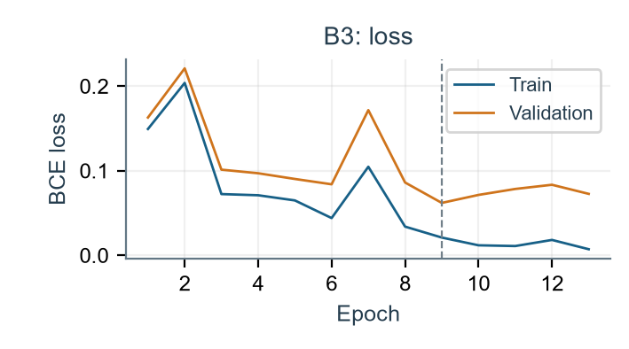
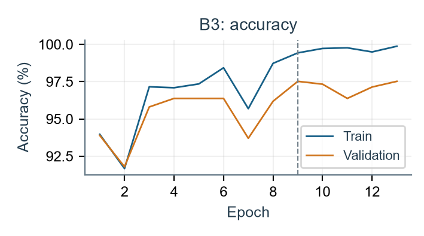
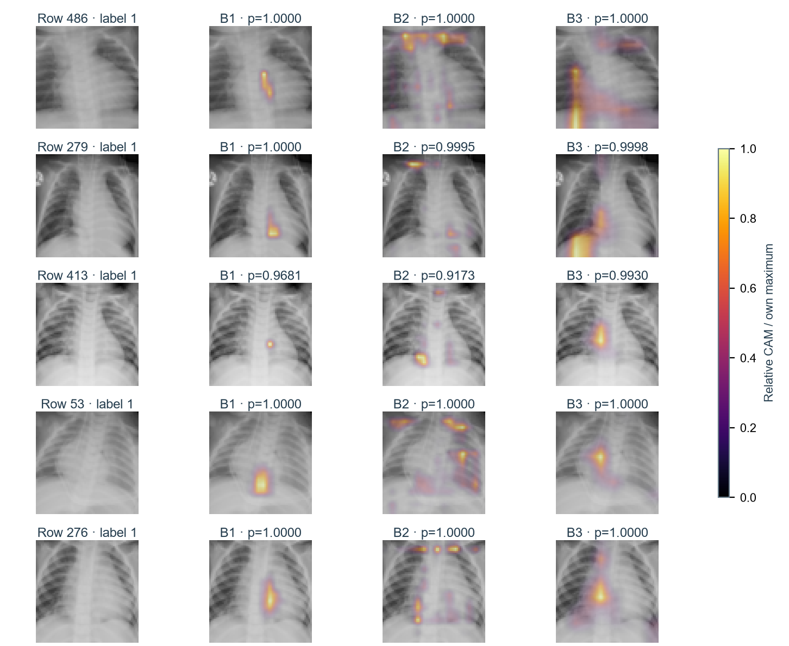

# SC4001 — Part B

Author: YourName | October 10, 2026

<!-- PDF page 1 -->
## Classification: B1–B4

### Generative AI declaration

I used OpenAI Codex / ChatGPT for planning, code generation/debugging, experiment execution, analysis, figures, report drafting and submission packaging. Verification included assignment/Q&A/library-source checks, behavioral tests, CUDA checkpoint restoration, saved-prediction metric/BCE checks, independent parameter/FLOPs formulas and artifact hashes. Grad-CAM tensors were reproduced by independent PyTorch autograd. All results below come from completed saved experiments. I remain responsible for reviewing and understanding the submitted work.

### Data, architecture interpretation and common protocol

Use the supplied 4,708/524/624 train/validation/test partitions and 64×64 grayscale images. Divide uint8 by 255 once, then normalize with training-pixel mean 0.5716994213 and population SD 0.1740975398. Q&A confirms 0=healthy, 1=pneumonia. Retain these original-training normalization statistics during final refits, following the brief; the FAQ only requires preprocessing refits for A1. Eight distinct images overlap train/validation; three extra copies occur within test. No exact train/test or validation/test matches were found, but patient independence cannot be checked without IDs.

Convolutions have no bias, then BN/ReLU; FC layers have bias; residual sums use ReLU. Q&A confirms SAME padding=kernel_size//2, including stride 2. It corrects the caption's 'all layers': B1/B2 final FC1 has an unrestricted logit with BCEWithLogitsLoss, no ReLU/dropout or prior sigmoid. Apply the same binary-loss interpretation to B3 (not separately specified in that answer). Sigmoid≥0.5 predicts class 1; B1 dropout 0.5 follows both hidden FC ReLUs, B2/B3 use none.

Selection: Adam, seed 42, 20-epoch cap, patience 4, minimum validation-loss improvement 0.0001; save lowest validation error, then lower loss, then earlier epoch. Candidate ties prefer smaller rate/batch. Per Q&A, initialize each final model fresh and refit on all 5,232 train+validation images for its selected 9/13/9 epochs (B1/B2/B3), with frozen hyperparameters, then evaluate test once. Fixed refits use no validation/test stopping. No augmentation, weighting or resampling; metrics use evaluation mode.

### B1. AlexNet-like learning-rate selection

Figure B1 is implemented as 5×5/16 → max pool → 5×5/32 → max pool → 3×3/64 → max pool → average output 4×4 → FC64 → FC32 → FC1, with dropout 0.5 only in hidden FC layers. All five rates use batch 128 and fresh initialization; 99,569 trainable parameters.

| Learning rate | Best epoch | Val. BCE loss | Val. error | Sensitivity | Specificity |
| --- | --- | --- | --- | --- | --- |
| 1e-05 | 18 | 0.283130 | 9.5420% | 97.1722% | 71.1111% |
| 1e-04 | 19 | 0.076439 | 3.0534% | 97.4293% | 95.5556% |
| 1e-03 | 9 | 0.064911 | 2.0992% | 98.2005% | 97.0370% |
| 1e-02 | 5 | 0.199377 | 5.9160% | 98.7147% | 80.7407% |
| 1e-01 | 17 | 0.103817 | 4.5802% | 96.1440% | 93.3333% |

Select LR=0.001, epoch 9: 11/524 validation errors (97.9008% accuracy), versus 16 for the next-best rate 0.0001. Every metric in a row belongs to that one saved checkpoint; stopping loss and error selection can prefer different epochs. The frozen learning rate supplies B2 and B3.

### Why sensitivity and specificity are necessary

Validation is 74.24% positive: predicting pneumonia for everyone would yield 74.24% accuracy, 100% sensitivity and 0% specificity. Sensitivity=TP/(TP+FN) measures detected positives; specificity=TN/(TN+FP) measures correctly rejected negatives. LR 0.01 has higher sensitivity than 0.001 but far lower specificity (80.74% versus 97.04%), a trade-off hidden by one aggregate score.

<!-- PDF page 2 -->
## B1 · learning curves and test; B2 selection table

Figure B1a–b. Separate loss and accuracy figures, each with all five validation and training curves. Stars mark saved checkpoints. Accuracy axes start at 70%; curves end at actual stopping epochs.

LR 1e-5 learns slowly: loss keeps falling at the 20-epoch cap, but best accuracy is only 90.46%. 1e-4 improves more gradually to 96.95% at epoch 19. 1e-3 reaches minimum loss at epoch 8, but epoch 9 has lower error; patience stops at 12. Its selected train/validation losses are 0.035620/0.064911. 1e-2 worsens in both train/validation loss and stops at 5, indicating an unfavorable optimization trajectory rather than a simple overfitting pattern. 1e-1 shows reversals and reaches only 95.42% best accuracy. Finite-budget stopping is not proof of global convergence; BN/dropout causes were not isolated.

### B1. One final test evaluation

| Test accuracy | Sensitivity | Specificity | TP / TN / FP / FN |
| --- | --- | --- | --- |
| 90.7051% | 97.6923% | 79.0598% | 381 / 185 / 49 / 9 |

The fresh nine-epoch combined-data refit misses 9 positives and labels 49/234 negatives positive. Test accuracy is 7.20 percentage points below selection validation accuracy; test specificity is 79.0598%. Prevalence changes affect accuracy but cannot alone explain lower specificity. Supplied overlap/dataset differences and refitting may contribute; their effects are not isolated. No settings or threshold were changed after test.

### B2. VGG-like batch-size selection, frozen LR=0.001

| Batch size | Best epoch | Val. BCE loss | Val. error | Sensitivity | Specificity |
| --- | --- | --- | --- | --- | --- |
| 16 | 13 | 0.069390 | 2.0992% | 98.9717% | 94.8148% |
| 32 | 13 | 0.090230 | 2.8626% | 96.9152% | 97.7778% |
| 64 | 6 | 0.097501 | 2.8626% | 98.7147% | 92.5926% |
| 128 | 5 | 0.135308 | 4.7710% | 98.7147% | 85.1852% |
| 256 | 16 | 0.085114 | 2.8626% | 98.2005% | 94.0741% |

Batch 16 wins uniquely with 11 errors, versus 15 for 32/64/256 and 25 for 128. Batch 32 has higher specificity, but the prescribed lowest-error criterion selects batch 16. LR/batch are frozen for B3.

<!-- PDF page 3 -->
## B2 · batch-size curves, interpretation and final test

The VGG-like model has two 3×3 Conv/BN/ReLU layers per width 8,16,32, each pair followed by max pooling, then global average pooling and FC1: 18,185 parameters, no dropout. All candidates share initial tensors and the underlying shuffled row sequence; batch grouping changes.

Figure B2a–b. Separate loss and accuracy figures for all five batches; validation above training. Stars mark error-selected checkpoints, not necessarily the minimum-loss epoch.

Batch 16 reaches minimum validation loss at epoch 9 (0.066596), but lowest error at 13 (0.069390); loss patience expires at 13. Its train/validation accuracies are 99.11%/97.90%. Batch 32 has a large epoch-6 loss spike/accuracy drop and then recovers, selecting 13. Batch 64 selects 6, then deteriorates through stopping at 10. Batch 128 begins near the positive-class majority rate, selects 5 and stops at 9. Batch 256 starts slowly, selects 16, and exhausts patience at the 20-epoch cap. Simultaneous train/validation reversals do not justify attributing every spike to overfitting.

### Batch size also changes the update budget

For batches 16/32/64/128/256, updates per epoch are 295/148/74/37/19. Selected checkpoints receive 3,835/1,924/444/185/304 updates; batch 16 receives 12.6× as many as batch 256. Smaller batches alter gradient/BN estimates, while larger batches make fewer updates per epoch. Gradient variance and BN effects were not separately measured. This one-seed comparison selects the required training recipe, not a universal batch-size ranking or an equal-update experiment.

### B2. One final test evaluation

| Test accuracy | Sensitivity | Specificity | TP / TN / FP / FN |
| --- | --- | --- | --- |
| 85.2564% | 100.0000% | 60.6838% | 390 / 142 / 92 / 0 |

The fresh thirteen-epoch combined-data refit misses 0 positives and makes 92 false positives. Specificity is 60.6838%, versus 94.8148% for the selection checkpoint on validation. Conditional specificity is not explained by prevalence alone. The distinct refit weights, supplied train/validation overlap and absent patient IDs limit interpretation; partitions and frozen choices were preserved.

<!-- PDF page 4 -->
## B3 · compact ResNet and architecture comparison

Use LR=0.001 and batch 16 exactly from B1/B2. Figure B3 has an initial 3×3/16 stage/max pool, then residual blocks at 16/32/64 channels; downsampling blocks use stride-2 main convolutions and 1×1 projections, with ReLU after sums. Global averaging feeds FC1. Seed 42 selects epoch 9: validation accuracy 97.5191%, loss 0.061988; loss stopping ends at 13.

Figure B3a–b. Training/validation curves; dashed line marks selected epoch 9. The growing later gap is consistent with overfitting; earlier simultaneous fluctuations have unisolated causes.

At selection epoch 9, train/validation accuracies are 99.43%/97.52%; by epoch 13 training reaches 99.87% while validation does not improve. A fresh nine-epoch combined-data refit then detects 390/390 positives and misclassifies 118/234 negatives; specificity is 49.5726%. The table uses all three fresh refits' saved final tests without re-evaluation.

| Model | Accuracy | Sensitivity | Specificity | Class. error | Parameters | FLOPs/image |
| --- | --- | --- | --- | --- | --- | --- |
| B1 AlexNet | 90.7051% | 97.6923% | 79.0598% | 9.2949% | 99,569 | 39,063,616 |
| B2 VGG | 85.2564% | 100.0000% | 60.6838% | 14.7436% | 18,185 | 19,464,256 |
| B3 ResNet | 81.0897% | 100.0000% | 49.5726% | 18.9103% | 77,169 | 25,325,696 |

FLOPs use one float32 1×1×64×64 evaluation input: 2 per convolution/FC multiply-add plus one per residual addition (28,672 for B3), checked against PyTorch profiler and executed-shape formulas [2]. Exclude BN, activations, pooling, FC bias addition, normalization/transfers, sigmoid/threshold and training work. These consistent scoped estimates are neither total scalar operations nor measured latency.

B1 retains a 4×4 spatial FC head and dropout, but has the most parameters/FLOPs (67,713 head parameters). B2 stacks small kernels with narrower channels/global averaging: fewest parameters/FLOPs, but compressed spatial information and no shortcuts. B3 provides residual gradient routes intended to ease deeper optimization [1], but wider channels/projections cost more than B2. Shortcut benefits were not isolated.

B1 has the highest observed accuracy; B1 the highest specificity. High sensitivity with lower specificity indicates many healthy images classified positive. One seed, different batches/selected epochs/update budgets, B1-only dropout and inherited tuning prevent attributing performance differences to architecture alone. The table does not trigger retuning.

[[1] He et al. (2016), Deep Residual Learning for Image Recognition.](https://arxiv.org/abs/1512.03385)

[[2] PyTorch 2.11 profiler documentation (formula-based convolution/matrix FLOP estimates).](https://docs.pytorch.org/docs/2.11/profiler.html)

<!-- PDF page 5 -->
## B4 · Grad-CAM on five shared random positive examples

NumPy PCG64 seed 42 uniformly samples five label-1 test rows without replacement; IDs were saved before maps, with no visual/prediction filtering. The fresh combined-data final checkpoints use main-path convolutions conv3.conv (B1), conv6.conv (B2), block64.conv2.conv (B3), all under features, before BN/ReLU; B3's shortcut is not separately mapped. Captum targets scalar pneumonia logits (target=None), evaluation mode with gradients enabled: spatially average gradients, weight channels, sum and ReLU [3,4]. Native grids 16×16/16×16/8×8 are bilinearly upsampled to 64×64 and divided by each map's own maximum.

Figure B4. Original pixels at left; shared inferno and opacity=0.55×heat, no flips. p is the saved final-test probability. Each map is normalized separately; colors are relative, not absolute evidence across models.

486: B1 overlaps central brightness; B2 emphasizes the upper edge; B3 the lower image-left boundary. 279: B1 is lower central; B2 upper-edge with weaker lower patches; B3 lower image-left. 413: B1/B3 overlap the bright center, B3 more broadly; B2 peaks lower image-left. 53: B1 is lower central, B2 scattered upper/right, B3 central-left. 276: B1 overlaps the bright central column, B2 favors upper/lower peripheral patches, B3 a broader central-left area. Directions refer to the displayed image.

Positive predictions among the five rows: 5/5/5 for B1/B2/B3. The lowest saved probability is B2 row 413: 0.9173. Coarse maps, normal structures within bright regions and absent lesion annotations prevent validating localization or causal border reliance. Five positive examples do not assess healthy/false-positive behavior. Duplicate selected-input padding matches final-test CUDA batch sizes; saved logits and independent autograd maps match exactly, with unchanged models and no full-test performance evaluation.

[[3] Selvaraju et al. (2017), Grad-CAM: Visual Explanations from Deep Networks.](https://arxiv.org/abs/1610.02391)

[[4] Captum 0.9.0 LayerGradCam documentation; positive-attribution ReLU is explicit.](https://captum.ai/api/layer.html#captum.attr.LayerGradCam)

